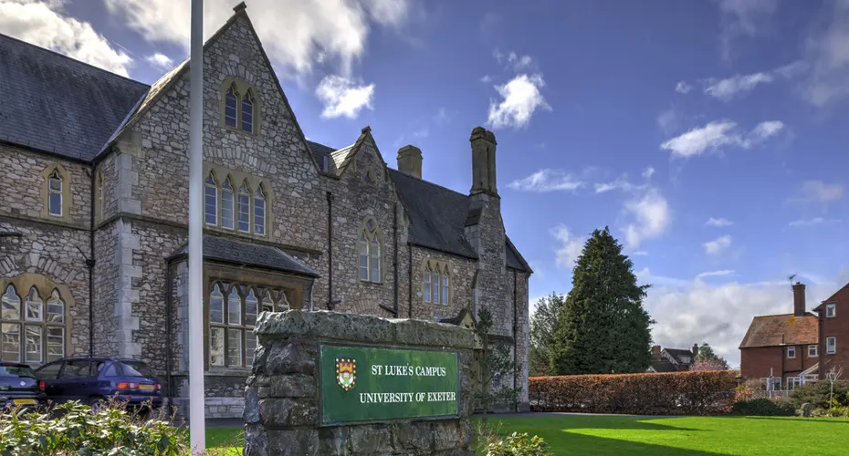

I am currently working as an health economist at [PenTAG](https://medicine.exeter.ac.uk/phss/research/pentag/), University of Exeter, UK. 

I appraise health economic models submitted as single technology assessment (STA) to the National Institute for Health and Care Excellence (NICE) in the UK. Alongside appraisal, I also build de novo / adapt guidance health economic models as part of multiple techonology assessment or consultancy projects.

Prior to joining PenTAG, I completed my PhD in Genetic Epidemiology from [Norwegian University of Science and Technology](https://www.ntnu.edu/)(NTNU), at the beautiful city of Trondheim in Norway 🥹. 

My PhD research focused on developing and applying statistical methods for genetic association studies, poslygenic risk scores with a particular emphasis on autoimmune disease.

And prior to my PhD, I worked as an Associate in the Advanced Analytics team at [Parexel](https://www.parexel.com/), a global contract research organization (CRO) providing biopharmaceutical services. I worked on various health economic and outcomes research (HEOR) projects, including cost-effectiveness analysis, indirect treatment comparisons, and regressional and survival analysis..
